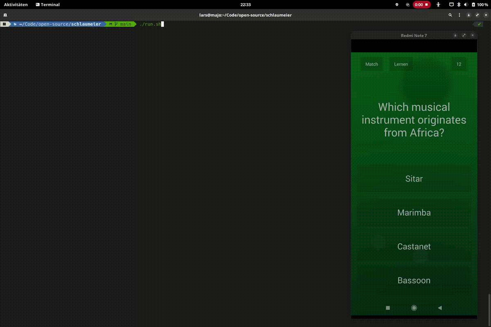
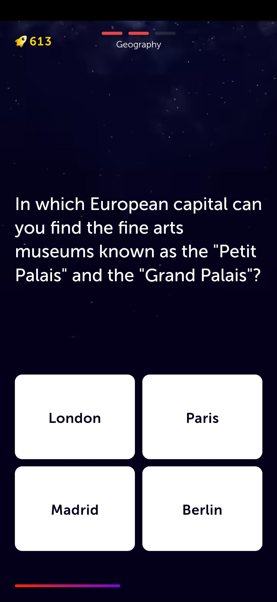

# 🧙‍♂️ schlaumeier

[](https://github.com/larswaechter/schlaumeier/actions/workflows/tests.yaml)

_schlaumeier_ is a bot written in Python that allows you to automatically solve Android quiz games like [QuizDuel](https://play.google.com/store/apps/details?id=se.maginteractive.quizduel2&hl=en&gl=US), [Quiz Planet](https://play.google.com/store/apps/details?id=com.lotum.quizplanet&hl=en&gl=US) or [General Knowledge Quiz](https://play.google.com/store/apps/details?id=com.timleg.quiz&hl=en&gl=US) using [ADB](https://developer.android.com/studio/command-line/adb), [OpenCV](https://opencv.org/) and OpenAI's [ChatGPT API](https://openai.com/blog/gpt-3-apps). In my case, I have tested it for solving questions from the games mentioned above but other ones should work as well with some adjustments. In general, it should work for any quiz game that consists of a question and multiple solutions to choose from. At the end of this README, you'll find a list of supported games that were successfully tested.

Simply put, the script operates by creating a screenshot, extracting the question / answers and passing them to ChatGPT, Claude or a local model. Alternatively, the screenshot can be passed directly to a vision model. The answer will be then entered on your device using the Android Debug Bridge (ADB). See below for more details on how it works.

Note that since ChatGPT isn't perfect and has limited knowledge, the answers given **are not always correct** too. Moreover, the API response times and its request limit might play a role depending on the game. For predicting the answer to a question, OpenAI's `gpt-5.6-terra` model is used by default. You can use another one by changing `GPT_MODEL` in your `.env` file.

This software was written for research purposes only and should not be used to gain an unfair advantage in any game. Most games **prohibit** the use of such tools. Always remember: **play fair** and respect the game♎.

## 💡 How it works



_schlaumeier_ makes use of two technologies among other things: [optical character recognition
](https://en.wikipedia.org/wiki/Optical_character_recognition) (OCR) and [large language models](https://blogs.nvidia.com/blog/2023/01/26/what-are-large-language-models-used-for/#:~:text=A%20large%20language%20model%2C%20or,successful%20applications%20of%20transformer%20models.) (LLMs). The core idea behind it, is actually quite simple:

1. Take a screenshot of the app using ADB
2. Slice the screenshot in 5 areas
   - Question
   - Answer A-D
3. Extract the text in each area using OpenCV
4. Send the question to the ChatGPT API
   - Including all possible answers
5. Extract the model's answer
6. "Touch" the answer on your phone using ADB
7. Repeat the procedure for each question

A question prompted to ChatGPT might looks like this for example:

```
Which musical instrument originates from Africa?
A: Sitar
B: Marimba
C: Castanet
D: Bassoon
```

As you can see, the possible solutions are provided at the end of the question. ChatGPT is instructed to reply with the letter of the correct answer only:

```
B
```

The given answer `B` is then processed in the following steps.

For now, the agent does not work completely autonomously. There's still some interaction of the user required. However, this depends for the most past on the game and can be changed according to personal preferences. Especially irregular ad popups can interrupt the game flow. The ADB `shell input tap x y` command is being used to trigger touch events on your phone.

Feel free to create a [fork](https://github.com/larswaechter/schlaumeier/fork) and develop a version for your preferred game!

## 📝 Requirements

The following software/hardware is required:

- Android Smartphone (or emulator)
  - Root is **not** required
  - [USB-Debugging](https://developer.android.com/studio/debug/dev-options#Enable-debugging) enabled
- An LLM: [ChatGPT API Key](https://devopsforu.com/how-to-connect-to-chat-gpt-api/), [Claude API Key](https://platform.claude.com/), [Ollama](https://ollama.com/) or any OpenAI compatible API
- Docker Setup
  - [Docker](https://www.docker.com/)
- Native Setup
  - [Python](https://www.python.org/) 3.12 or newer
  - [Tesseract](https://github.com/tesseract-ocr/tesseract) (not required for `SCREEN_READER=vision`, except for `cropper.py`)
  - [ADB-Tools](https://developer.android.com/studio/command-line/adb)

Especially the Tesseract version, that is used to recognize texts on images, plays a major role. I've tested the following one, which works quite well for the English language:

```
tesseract 5.3.0
 leptonica-1.82.0
  libgif 5.2.1 : libjpeg 8d (libjpeg-turbo 2.1.4) : libpng 1.6.39 : libtiff 4.5.0 : zlib 1.2.13 : libwebp 1.3.0 : libopenjp2 2.5.0
 Found AVX2
 Found AVX
 Found FMA
 Found SSE4.1
 Found OpenMP 201511
 Found libarchive 3.6.2 zlib/1.2.13 liblzma/5.2.9 bz2lib/1.0.8 liblz4/1.9.4 libzstd/1.5.2
 Found libcurl/7.87.0 OpenSSL/3.0.8 zlib/1.2.13 brotli/1.0.9 zstd/1.5.2 libidn2/2.3.4 libpsl/0.21.2 (+libidn2/2.3.4) libssh2/1.10.0 nghttp2/1.52.0
```

I noticed some rare cases, when Tesseract was not able to identify the text. That was when a text contained only a single letter or number. However, most of the time it works.

Unfortunately, the changes between the individual Tesseract versions do not make a consistent testing easy. That's why the [tests](https://github.com/larswaechter/schlaumeier/blob/main/tests.py) of the image pipeline use a fake OCR. Only the tests on real screenshots require Tesseract: they tolerate small differences in the recognized texts and are skipped if it's not installed.

## 🖥️ Setup

First of all, create a new environment file:

```bash
cp .env.example .env
```

Enter your ChatGPT API KEY (or see [LLM provider](#llm-provider) for using a local model instead):

```
GPT_KEY=YOUR_KEY
```

Enter the language for Tesseract. This should match the language of your Android Game. Make sure that you have the according [language pack](https://tesseract-ocr.github.io/tessdoc/Data-Files-in-different-versions.html) installed on your system.

```
TESSERACT_LANG=YOUR_LANG
```

Next, enter the screen slices for the question its possible answers, which depend on your phone's display. The slices are later used to crop the screenshot in smaller square images and extract the text in each of them.

The values (coordinates) are encoded as `heightFrom:heightTo-widthFrom:widthTo`.

```
SLICE_Q=300:1000-0:1080
SLICE_ANSW_A=1040:1280-50:1020
SLICE_ANSW_B=1335:1575-50:1020
SLICE_ANSW_C=1630:1870-50:1020
SLICE_ANSW_D=1925:2165-50:1020
```

If your game has more than 4 answers (A-D) you can simply provide more (or less) by adding more environment variables like `SLICE_ANSW_E`, `SLICE_ANSW_F` and so on until maximum `Z`. The letters have to be consecutive.

**TIP**: You can find the coordinates easily by enabling [Pointer Location](https://developer.android.com/studio/debug/dev-options#input) in your phone's developer options. Moreover, use the [`cropper.py`](https://github.com/larswaechter/schlaumeier/blob/main/cropper.py) script to crop your screenshot and to inspect the cropped images.

Assuming the following scenario:



In this example, the slice for correct answer (C) ranges vertically from `y_1=1630` to `y_2=1870` and horizontally from `x_1=50` to `x_2=1020`. So the image for answer C, cropped based on these coordinates, looks like this:


The lightgreen rectangle marks the text on the image recognized by Tesseract. Make sure that there's **no border left** when cropping the image. Otherwise, you might get some problems when recognizing the text snippets. See more examples [here](https://github.com/larswaechter/schlaumeier/tree/main/examples).

For the next steps, make sure your phone is **connected via USB**. You have to allow the USB debugging connection on your phone when running the script for the first time. You can run _schlaumeier_ either with Docker or natively.

### LLM provider

_schlaumeier_ can use different language models. Choose one with `LLM_PROVIDER` in your `.env` file:

| `LLM_PROVIDER`     | Model                                                 | Required settings                      |
| ------------------ | ----------------------------------------------------- | -------------------------------------- |
| `openai` (default) | ChatGPT in the cloud                                  | `GPT_KEY`, `GPT_MODEL`                 |
| `anthropic`        | Claude in the cloud                                   | `ANTHROPIC_API_KEY`, `ANTHROPIC_MODEL` |
| `ollama`           | A local model using [Ollama](https://ollama.com/)     | `OLLAMA_MODEL`                         |
| `custom`           | Anything else that provides an OpenAI compatible API  | `CUSTOM_URL`, `CUSTOM_MODEL`           |

Cloud providers charge per request and receive the extracted texts or screenshots. With a local model, everything stays on your machine, but it requires enough memory to run it.

To use a local model, download it and enable it in your `.env` file:

```bash
ollama pull qwen3-vl:8b
```

```
LLM_PROVIDER=ollama
OLLAMA_MODEL=qwen3-vl:8b
```

When running in Docker, Ollama on your host machine is reachable using `OLLAMA_URL=http://host.docker.internal:11434/v1` (Docker Desktop).

To use any other OpenAI compatible API, for example a different local server, set its URL and model. `CUSTOM_KEY` is only required if the server checks it.

```
LLM_PROVIDER=custom
CUSTOM_URL=http://localhost:1234/v1
CUSTOM_MODEL=YOUR_MODEL
CUSTOM_KEY=YOUR_KEY
```

### Screen reader

Independently of the provider, you can choose how the screen is read with `SCREEN_READER`:

|                   | `tesseract` (default)              | `vision`                      |
| ----------------- | ---------------------------------- | ----------------------------- |
| Text is read by   | Tesseract                          | The LLM                       |
| The LLM receives  | The extracted texts                | A screenshot                  |
| Requires          | Tesseract and its language pack    | A model that supports images  |

With `vision`, the screenshot is cropped to your slices and a letter is drawn on each answer. Check `screenshots/img_vision.jpg` to see what the model receives. The letter is placed in the top left corner of the slice, so make sure that it doesn't cover the answer. The slices are still required: they tell _schlaumeier_ where to touch the screen.

In a small test on an Apple M4 with 16 GB of memory, `qwen3-vl:8b` took about 20 seconds per question using `vision` (17-28 seconds, the first one takes longer because the model has to be loaded), which might be too slow for games with a short time limit.

### Docker

Build the Docker image:

```bash
docker build . -t schlaumeier
```

and run a new container:

```bash
docker run \
   --privileged \
   --env-file .env \
   --rm \
   -p 5037:5037 \
   -it \
   schlaumeier
```

Make sure that there's no ADB server instance running on your host machine.

### Native

For the native setup, the tools listed above are required and you have to install the pip packages:

```bash
pip install -r ./requirements.txt
```

Last but not least run the script:

```bash
./run.sh
```

Alternatively, you can also run `main.py` directly.

The script starts the ADB server and waits for a device to be connected. As described above, _schlaumeier_ takes a screenshot, extracts each text part and forwards the question to ChatGPT. During execution, you'll see some helpful console output. Moreover, the screenshots are saved to the [`screenshots`](https://github.com/larswaechter/schlaumeier/tree/main/screenshots) directory. They are deleted before each run.

If a text can't be recognized, the API request fails or the model gives no definite answer, you're asked to enter the answer yourself. Leave it empty to skip the question.

The answer is automatically entered by the script using a touch event. Afterwards, you can press `Enter` to continue and the procedure is repeated. Press `Ctrl+c` to stop the script at any time.

## 🤖 Claude Code skill

Instead of running the script, you can let [Claude Code](https://claude.com/product/claude-code) play: the `/schlaumeier` skill looks at your phone, chooses an answer and taps it. No slices, API key or Tesseract are required, but your Claude Code usage applies. Screenshots are sent to Anthropic.

It accesses your phone with the MCP server in [`mcp_server.py`](https://github.com/larswaechter/schlaumeier/blob/main/mcp_server.py), which only provides two tools: `get_screenshot` and `tap`. Claude can't run any other commands on your phone.

Install [ADB](https://developer.android.com/studio/command-line/adb) and the dependencies into a virtual environment:

```bash
python3 -m venv .venv
.venv/bin/pip install -r requirements.txt
```

Connect your phone, run `adb start-server`, check that it's listed by `adb devices` and start `claude` in this directory. Approve the `schlaumeier` MCP server when asked and open a question in your game:

```
/schlaumeier
/schlaumeier 5
/schlaumeier all
```

The first one solves the current question, the second one solves the next five and the third one keeps going without a limit. Press `Esc` to stop it at any time. Between rounds, the skill may tap buttons that are clearly free, like "Next" or "Continue". It stops at anything else, like ads, purchase dialogs, paid offers or screens it can't identify. Long runs use up your Claude Code usage quickly, so keep an eye on them. If multiple devices are connected, select one by setting `ADB_SERIAL` to its serial.

## 🎮 Support

_schlaumeier_ has been successfully tested for the following Android games:

- [QuizDuel](https://play.google.com/store/apps/details?id=se.maginteractive.quizduel2&hl=en&gl=US)
- [Quiz Planet](https://play.google.com/store/apps/details?id=com.lotum.quizplanet&hl=en&gl=US)
- [General Knowledge Quiz](https://play.google.com/store/apps/details?id=com.timleg.quiz&hl=en&gl=US)

Feel free to add more to the list!

## 🔑 License

_schlaumeier_ is released under [MIT](https://github.com/larswaechter/schlaumeier/blob/main/LICENSE) license.
